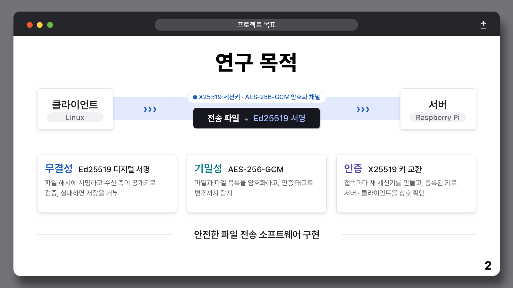
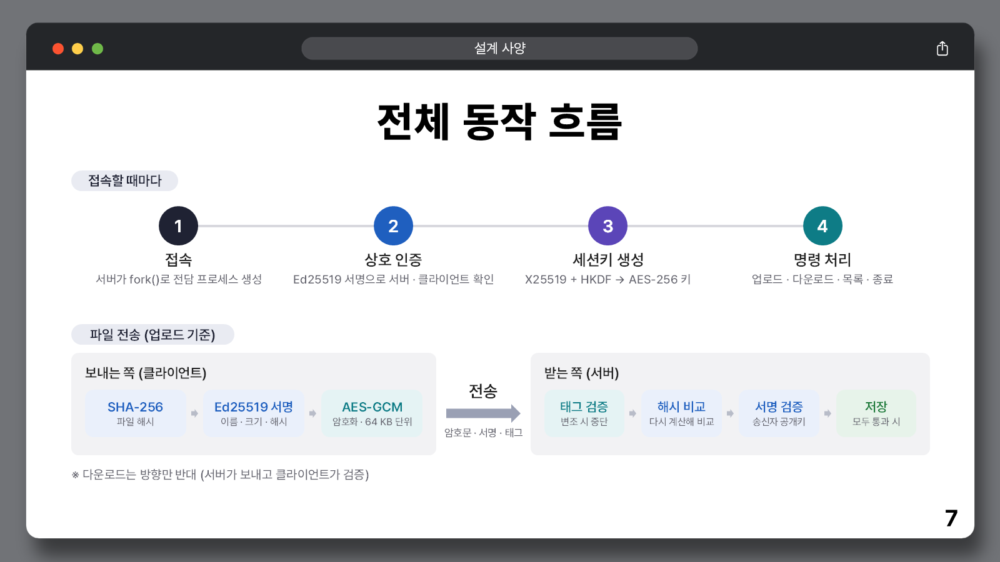
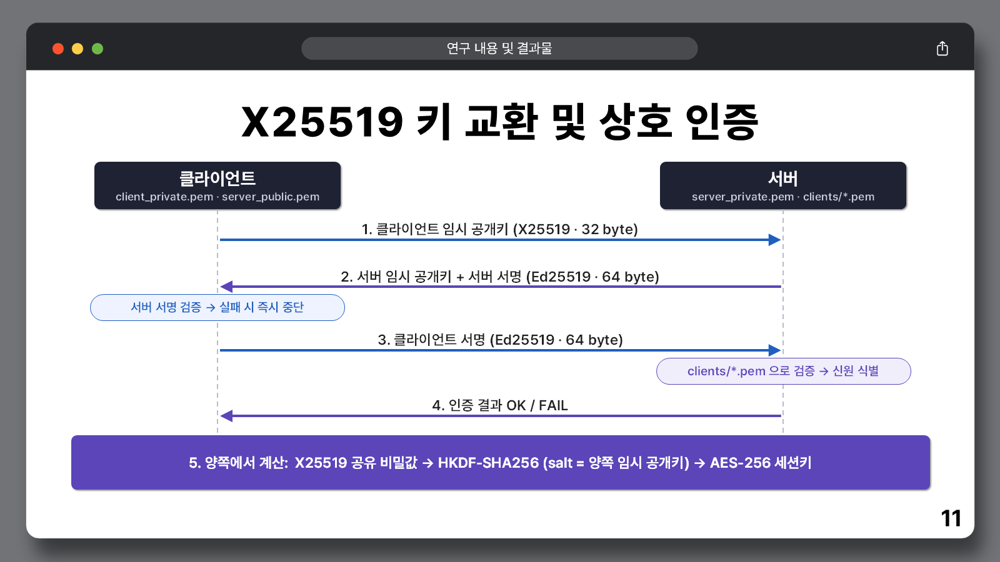
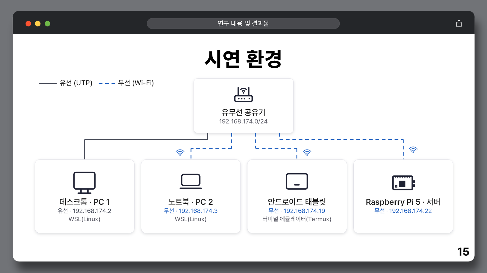

# Digital Signature 및 AES-256-GCM 기반 파일 전송 SW

[](https://github.com/jaehun6912/capstone-secure-file-transfer/actions/workflows/ci.yml)


**2026 캡스톤디자인 · 팀 해시브라운**

C와 OpenSSL로 구현한 TCP 파일 전송 프로그램입니다. **Ed25519 기반 Digital Signature**으로 파일 무결성과 송신자를 확인하고, **AES-256-GCM**으로 파일과 서버 파일 목록을 암호화합니다. 접속할 때마다 **X25519 키 교환 + HKDF-SHA256**으로 새 세션키를 만들고, 미리 등록한 공개키로 서버와 클라이언트를 **상호 인증**합니다.

Raspberry Pi 5 서버에 PC 2대(WSL)와 Android 태블릿(Termux)이 동시에 접속하는 환경에서 시연했습니다.



## 주요 기능

| 영역 | 구현 내용 |
| --- | --- |
| **무결성** | 파일명·크기·SHA-256 해시를 묶어 Ed25519로 서명하고, 수신 측이 해시를 다시 계산해 서명과 함께 검증. 하나라도 실패하면 저장 거부 |
| **기밀성** | AES-256-GCM, 64 KiB 청크 스트리밍, 매 전송 12바이트 난수 IV, 16바이트 인증 태그. 서명 대상 정보를 AAD로 묶어 메타데이터 변조도 탐지 |
| **인증·키 관리** | 접속마다 임시 X25519 키 쌍 생성 → 양쪽이 Ed25519로 서명해 상호 인증 → HKDF-SHA256으로 32바이트 세션키 유도 |
| **다중 클라이언트** | `fork()`로 접속마다 전담 프로세스 생성, `clients/*.pem` 공개키 등록으로 클라이언트 식별 (서버 재시작 불필요) |
| **안전한 저장** | `파일명.<PID>.tmp`에 먼저 수신 → 태그·해시·서명 검증을 모두 통과한 경우에만 `rename()`으로 확정 |
| **사용성** | 번호 메뉴, 서버/내 파일 목록에서 번호로 선택, 서버 파일 목록도 AES-GCM으로 암호화해 전송 |

## 동작 구조



접속하면 서버가 `fork()`로 전담 프로세스를 만들고, 아래 핸드셰이크로 서로를 확인한 뒤 세션키를 만듭니다.



- 클라이언트는 사전 배포된 `server_public.pem`으로 서버 서명을 검증하고, 실패하면 즉시 중단합니다. 이를 통해 가짜 서버나 중간자 공격에 대응합니다.
- 서버는 `clients/` 안의 공개키로 클라이언트 서명을 차례로 검증하고, 일치하는 키의 파일명(예: `pc1`)을 그 클라이언트의 신원으로 사용합니다.
- 서명 대상에는 역할 문자열(`X25519-SERVER` / `X25519-CLIENT`)과 양쪽 임시 공개키가 함께 들어갑니다. 따라서 한 방향의 서명을 반대 방향에 재사용할 수 없습니다.


## 기술 스택

| 구분 | 사용 기술 |
| --- | --- |
| 언어 / 빌드 | C11, GCC, Make |
| 암호 라이브러리 | OpenSSL 3 EVP API (`libcrypto`) |
| 알고리즘 | Ed25519, X25519, HKDF-SHA256, AES-256-GCM, SHA-256 |
| 네트워크 / 동시성 | POSIX TCP 소켓, `fork()` |
| 실행 환경 | Raspberry Pi 5 (서버), WSL Ubuntu, Android Termux (클라이언트) |

## 프로젝트 구조

```text
.
├── src/                    # 최종 버전 (실행 기준)
│   ├── server.c            # 접속 수락·fork·클라이언트 식별·파일 저장/전송·암호화된 목록
│   ├── client.c            # 키 교환·메뉴·업로드/다운로드·수신 검증
│   ├── eddsa.c             # Ed25519 서명/검증 (PEM 키)
│   ├── aes.c               # AES-256-GCM 스트리밍 암복호화
│   ├── x25519.c            # 임시 X25519 키·공유 비밀값·HKDF-SHA256
│   └── Makefile
├── history/                # 개발 과정 단계별 소스 (01 소켓 → 04 EdDSA+AES)
├── docs/
│   ├── ARCHITECTURE.md     # 구현 분석·단계별 변화·한계
│   ├── SETUP.md            # 키 생성·실행 안내
│   ├── VALIDATION.md       # 검증 기록
│   ├── presentations/      # 발표 자료 PDF 4종
│   └── images/
├── scripts/smoke_test.py   # 로컬 통합 테스트
└── .github/workflows/ci.yml
```

## 빠른 시작

Linux/POSIX 환경(Windows는 WSL)에서 C11 컴파일러, Make, OpenSSL 개발 헤더가 필요합니다.

```bash
sudo apt update && sudo apt install -y build-essential libssl-dev openssl
make -C src                    # → src/build/server, src/build/client
python3 scripts/smoke_test.py  # 임시 키로 업로드·다운로드·인증 거부까지 자동 확인
```

키 생성과 서버·클라이언트 작업 폴더 구성은 **[실행 안내](docs/SETUP.md)**를 참고하세요. 클라이언트에서 서버 IPv4 주소와 포트 `10101`을 입력하면 아래 메뉴가 나타납니다.

| 입력 | 기능 |
| --- | --- |
| `1` / `up` | 내 `Files/` 목록에서 번호로 골라 업로드 |
| `2` / `down` | 서버 파일 목록에서 번호로 골라 다운로드 |
| `3` / `slist` | 서버 파일 목록 조회 (AES-GCM 암호화 전송) |
| `4` / `clist` | 내 파일 목록 조회 |
| `0` / `exit` | 접속 종료 |

## 개발 과정

1학기에는 소켓과 서명을, 2학기에는 암호화와 키 교환을 구현했습니다. 단계마다 프로토콜이 다르므로 서버와 클라이언트는 같은 단계끼리 사용해야 합니다.

| 단계 | 구현 내용 | 발표 자료 |
| --- | --- | --- |
| [01 소켓](history/01-socket/) | TCP 소켓 연결과 메시지 송수신 | [중간 발표 · 2026-04-20](docs/presentations/01-midterm-2026-04-20.pdf) |
| [02 파일 전송](history/02-file-transfer/) | 기본 파일 업로드·다운로드 | — |
| [03 EdDSA](history/03-eddsa/) | SHA-256 해시 + Ed25519 서명 검증, 공개키 변조 시 거부 | [기말 발표 · 2026-06-01](docs/presentations/02-end-of-term-2026-06-01.pdf) |
| [04 EdDSA + AES](history/04-eddsa-aes/) | 사전 공유 AES 키로 AES-256-GCM 암호화 전송 | [2학기 발표 · 2026-09-07](docs/presentations/03-semester2-2026-09-07.pdf) |
| [**최종**](src/) | X25519 세션키, 상호 인증, 다중 접속, 메뉴·암호화된 파일 목록 | [**최종 발표 · 2026-10-12**](docs/presentations/04-final-2026-10-12.pdf) |

9월 발표 이후 최종 버전에서 개선한 점은 다음과 같습니다.

| 항목 | 2학기 발표 (9/7) | 최종 (10/12) |
| --- | --- | --- |
| 세션키 | `aes_key.bin`을 양쪽에 미리 복사 | X25519 키 교환으로 접속마다 새 AES-256 키 |
| 접속 인증 | 없음 (파일 서명만 검증) | Ed25519로 서버·클라이언트 상호 인증 |
| 클라이언트 키 | 서버는 `client_public.pem` 하나만 신뢰 | `clients/*.pem` 등록으로 여러 클라이언트 식별 |
| 동시 접속 | 한 번에 1대 | `fork()`로 여러 대 동시 접속 |
| 서명 입력 | 파일 전체 + 해시 (파일 크기만큼 메모리 할당) | 파일명·크기·해시 구조체 (고정 296바이트) |

## 시연 환경



## 검증

저장소 정리 과정에서 WSL Ubuntu 24.04 / OpenSSL 3.0.13 환경으로 다음을 확인했습니다. 같은 검사가 GitHub Actions에서도 자동으로 실행됩니다.

- 최종 버전 빌드 경고 0건, 과거 단계 4개 모두 컴파일 성공
- 64 KiB를 넘는 바이너리 파일과 빈 파일의 업로드·다운로드, 바이트 단위 일치 확인
- 미등록 클라이언트 키와 잘못된 서버 공개키로 접속 시 거부
- 두 클라이언트 병렬 접속, 전송 후 임시 파일 정리


## 한계 및 개선 방향

- 구조체를 그대로 전송하므로 정식 직렬화 형식이 없습니다. `_Static_assert`로 크기만 고정했습니다.
- 명령, 파일명, 크기 등 일부 메타데이터는 평문입니다. 채널 전체를 보호하는 TLS 수준이 아닙니다.
- 사용자별 저장소 분리, 접근 권한, 재전송 방지, 동시 접속 수 제한은 구현하지 않았습니다.

## 팀과 역할

| 팀원 | 역할 |
| --- | --- |
| 강정우 | 파일 전송 구현, OpenSSL 사용법 학습 |
| 이원준 | 디지털 서명 및 무결성 검증 모듈 구현 (OpenSSL) |
| **최재훈** | **개발 환경 구성, 기능 통합 및 테스트, 보고서 작성** |
